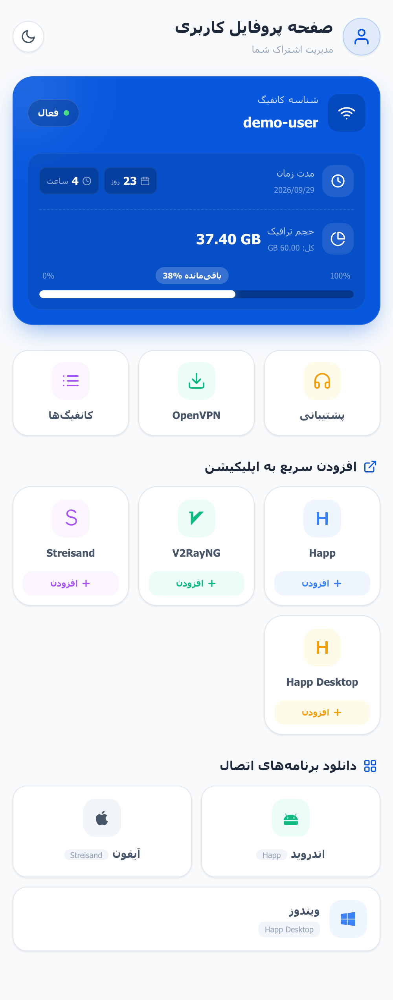

# PasarGuard Sub Page

A subscription page for the PasarGuard panel that opens in Persian, right to left, and can be switched to English or Russian. One file, no outside requests.

<div align="center">
  
</div>

[فارسی](README.fa.md)

---

## Why one file

The subscription page is the one page your users **must** be able to open. A page that reaches out to a CDN for its font, its icons or its CSS breaks wherever that CDN is blocked, which for this audience is most of the time. Everything here ships inside the file: the styles, the script, and the QR encoder. The only thing loaded from elsewhere is the app icons, whose URLs the panel itself supplies, and a row whose icon fails to load still renders correctly.

## What it shows

- A **usage ring** with the percentage, turning amber past 75% and red past 90%
- Used, total and remaining traffic
- Expiry date and days left, or the plan length for a user who has not started yet
- Status: active, on hold, expired, out of data, disabled
- A **Support** button that opens the panel's announcement URL, when one is set
- **Apps**, grouped into tabs by platform, with the visitor's own platform selected, plus download cards for apps that have download links
- **Configs** with a protocol badge, copy, copy-all and a QR code, under a notice asking the customer to import the subscription link rather than adding configs one by one
- An **OpenVPN download** button for users who have it
- An **L2TP** box with the server, username, password and pre-shared key, for users who have L2TP
- **WireGuard** and **Telegram (MTProto)** in their own sections
- A **single-device notice** in place of the configs when the panel hides them because the subscription is locked to one device (HWID)
- WireGuard, VLESS, VMess, Trojan, Shadowsocks, Hysteria2, TUIC, MTProto, and anything else the panel emits
- A Persian / English / Russian switch; the page opens in Persian unless the visitor picked another language before
- Dark and light themes with a toggle that remembers the choice

## Install

### Automatic

```bash
bash <(curl -fsSL https://raw.githubusercontent.com/Free-Guy-IR/pasarguard-sub-page/main/install.sh)
```

It writes the template to `/var/lib/pasarguard/templates/subscription/index.html`, sets `CUSTOM_TEMPLATES_DIRECTORY` in the panel's `.env`, and restarts the panel.

`install.sh` and `install.sh --rollback` take a lock so they never run over each other, and keep a checksummed backup of the page and the `.env` so a rollback restores exactly what was there. Let the installer be the only thing that writes the page and `.env`; a file hand-edited in the instant the installer is swapping it in is the one case it cannot protect.

### By hand

```bash
mkdir -p /var/lib/pasarguard/templates/subscription
curl -fsSL -o /var/lib/pasarguard/templates/subscription/index.html \
  https://raw.githubusercontent.com/Free-Guy-IR/pasarguard-sub-page/main/index.html
```

Then in the panel's `.env`:

```ini
CUSTOM_TEMPLATES_DIRECTORY=/var/lib/pasarguard/templates/
SUBSCRIPTION_PAGE_TEMPLATE=subscription/index.html
```

Recreate the panel's container so it reads the new `.env`; `docker compose restart` keeps the old environment:

```bash
cd /opt/pasarguard && docker compose up -d pasarguard
```

If the panel runs in Docker, make sure the templates directory is mounted into the container:

```yaml
services:
  pasarguard:
    volumes:
      - /var/lib/pasarguard/templates:/var/lib/pasarguard/templates
```

---

## A different page for each admin

The panel already supports this; no code change is needed. When a subscription link is opened, the panel looks at the `sub_template` of the user's own admin first, and falls back to the global template when it is empty.

**1. Copy the template for that admin**

```bash
mkdir -p /var/lib/pasarguard/templates/reseller_ali
cp /var/lib/pasarguard/templates/subscription/index.html \
   /var/lib/pasarguard/templates/reseller_ali/index.html
```

**2. Make it theirs.** The whole palette derives from one line near the top:

```css
--hue: 250;
```

`210` is blue, `160` green, `20` orange, `340` pink. The `<title>` and the header text are in the same file.

**3. Point the admin at it.** In the dashboard: **Admins** → the admin → **Subscription Template** → enter the path *relative to the templates directory*:

```
reseller_ali/index.html
```

Or through the API:

```bash
curl -X PUT "https://panel.example.com/api/admin/reseller_ali" \
  -H "Authorization: Bearer $TOKEN" \
  -H "Content-Type: application/json" \
  -d '{"sub_template": "reseller_ali/index.html"}'
```

**4. Check it** by opening the subscription link of one of that admin's users. Everyone else keeps the default page. Clear the field to put an admin back on the default.

Editing a template file takes effect on the next page load; no restart. A path that does not exist raises an error, so try it on a test user first. An admin cannot use this field to read other files on the server: Jinja rejects paths outside the templates directory.

---

## What the panel passes to the template

| Variable | Meaning |
|---|---|
| `user.username` | the username |
| `user.status.value` | `active` / `on_hold` / `expired` / `limited` / `disabled` |
| `user.used_traffic` | bytes used |
| `user.data_limit` | bytes allowed; `0` or empty means unlimited |
| `user.expire` | expiry date |
| `user.on_hold_expire_duration` | seconds, for a user who has not started |
| `links` | the config strings |
| `apps` | each with `name`, `icon_url`, `import_url`, `platform.value`, `description`, `download_links`; an app button links to `import_url` only when its scheme is in `app_schemes` inside the `appurl` macro (happ, v2rayng, v2box, streisand, sing-box, hiddify, clash and other VPN clients, plus https); add your client's scheme there if it is missing |
| `announce` / `announce_url` | the announcement text and its URL; this page uses only `announce_url`, for the Support button |
| `has_openvpn` | whether the user has any OpenVPN config |
| `openvpn_configs` | the OpenVPN files, each with `filename`, `protocol`, `content`, `remotes` |
| `l2tp_details` | the L2TP servers, each with `server`, `username`, `password`, `secret`, `remark` |
| `configs_hidden_by_hwid` | true when the configs are withheld because the subscription is locked to one device |

Filters: `bytesformat`, `datetime`, `yaml`, `only`, `except`. The `now()` global is available too.

---

## Compatibility

Tested against PasarGuard v5. It works with forks that have not changed the subscription template contract. The OpenVPN, L2TP and single-device parts need a panel that passes `openvpn_configs`, `l2tp_details` and `configs_hidden_by_hwid`, as the Free-Guy-IR panel does; on a panel that does not, those parts stay hidden and the rest of the page works as usual.

## License

MIT
